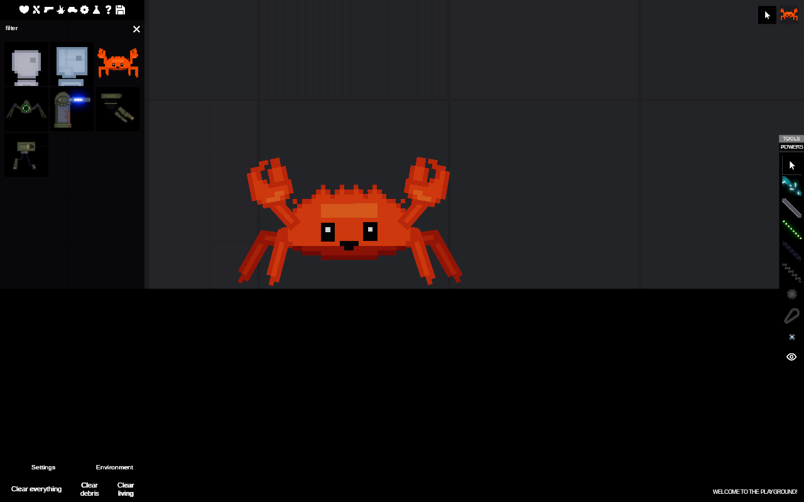

# People Playground Rewrite

> [!IMPORTANT]
> **You need your own copy of People Playground on Steam (version 1.28.54, the current beta, or 1.28.41).** The rewrite reads everything it needs from your install when it runs: the art, sounds, maps and items from the game's asset files, and the game's numbers, tables and text from the game's own program file (`Assembly-CSharp.dll`). No game files or game numbers come with this repository, and it doesn't run without the game.

People Playground rewritten in Rust on [Bevy](https://bevyengine.org): the same humans, androids, items, maps, menus and physics, checked against the running game. The physics is a Rust rewrite of the Box2D build inside the game's engine, compared bit for bit with it.

It's meant for experimenting and modding: the whole game is open Rust source you can read, change and rebuild. It isn't a way to play without buying the game.

It was written with AI coding tools (Claude). It isn't affiliated with or endorsed by Studio Minus. People Playground and its assets belong to Studio Minus.

## Setup (Windows)

1. Install People Playground from Steam.
2. Download this repository (Code > Download ZIP, or `git clone`).
3. Double-click `ppg-rewrite.bat`. If Rust isn't installed, it offers to install it (free, a few GB with Microsoft's C++ build tools). The first build takes a few minutes; after that it starts in seconds.
4. On first launch it finds your Steam copy of People Playground by itself. If it can't (the game is installed somewhere unusual), its window asks you to drop your People Playground folder onto it or paste the folder's path (in Steam: right-click People Playground > Manage > Browse local files). You can also drag that folder onto `ppg-rewrite.bat`. It remembers the folder.

It then builds a small cache from your game files in `%LOCALAPPDATA%`, once. The rewrite follows versions 1.28.41 and 1.28.54 (the 1.28.54 parts are not yet checked against the real game as closely as 1.28.41): if your install is another version, it says so and doesn't start.

### Starting it from Steam

Either:
- **As its own entry:** Steam > Games > Add a Non-Steam Game to My Library > Browse, set the file type to All Files, pick `ppg-rewrite.bat`, then Add Selected Programs.
- **From People Playground's own entry:** right-click People Playground > Properties > General > Launch Options, and enter `"C:\path\to\ppg-rewrite.bat" %command%` (with your path). Steam passes the game's location to the rewrite, and the original game doesn't start. Clear the line to get the original game back.

### Command line

`ppg-rewrite.bat --game-dir "D:\Games\People Playground"` uses that install; `--cache <folder>` puts the cache somewhere else.

## Modding

Everything is in `src/`: the game's behaviours in `src/game`, the physics in `src/b2`, the menus in `src/ui`, rendering in `src/*.rs` and `src/*.wesl`. Change it and run `ppg-rewrite.bat` again to rebuild. If you share a mod built on this, each of its players needs their own copy of People Playground too. Don't ship the game's files, or numbers taken out of them, with it.

## Third-party code

See [THIRD_PARTY_NOTICES.md](THIRD_PARTY_NOTICES.md).
